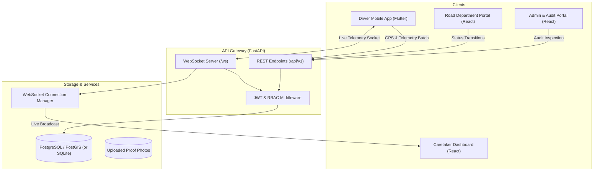

# SafeDrive AI — System Architecture & Master Blueprint

## 1. System Overview

SafeDrive AI is a multi-tier, multi-vehicle road safety and driver intelligence platform comprising:
1. **Driver Mobile Application (Flutter/Dart)**: Runs on Android/iOS, collecting GPS, accelerometer, and sensor telemetry. Provides turn-by-turn safe navigation, driving state alerts, road issue reporting, and crash/SOS detection.
2. **Cloud API Gateway & Backend (FastAPI/Python)**: High-performance asynchronous REST and WebSocket server with role-based access control (RBAC), database persistence, and real-time telemetry broadcast.
3. **Caretaker Web Dashboard (React/TypeScript)**: Consent-governed live fleet tracking, driver risk score breakdown, trip history replay, and emergency center.
4. **Road Department Portal (React/TypeScript)**: Prioritized road hazard queue, verification workflows, and audit history.
5. **Admin & Security Console (React/TypeScript)**: Health checks, role governance, and immutable audit logs.
6. **Data Storage & State**: PostgreSQL with PostGIS for spatial operations, SQLite for zero-config local development, and Redis for live socket coordination.

---

## 2. Multi-Vehicle Configuration Architecture

Unlike typical one-size-fits-all telematics apps, SafeDrive AI calibrates event thresholds and safety scoring by vehicle category:

| Vehicle Category | Harsh Brake Threshold | Harsh Accel Threshold | Sharp Turn Rate | Max Safe Speed | Rest Reminder Interval |
| :--- | :--- | :--- | :--- | :--- | :--- |
| **Bike** | -0.55 g | +0.50 g | 45°/s | 80 km/h | 1.5 hours |
| **Scooter** | -0.50 g | +0.45 g | 40°/s | 70 km/h | 1.5 hours |
| **Car** | -0.45 g | +0.40 g | 35°/s | 110 km/h | 2.5 hours |
| **Taxi** | -0.42 g | +0.38 g | 32°/s | 100 km/h | 2.0 hours |
| **Truck** | -0.35 g | +0.30 g | 25°/s | 80 km/h | 3.0 hours |
| **Bus** | -0.32 g | +0.28 g | 22°/s | 75 km/h | 2.5 hours |

---

## 3. Real-Time Telemetry & WebSocket Pipeline

1. **Driver Streaming**: When a trip starts, the mobile app batches GPS locations and sensor readings every 2–3 seconds to preserve battery.
2. **Persistence**: Locations are bulk-inserted into `trip_locations`.
3. **Broadcast**: The `ConnectionManager` filters active caretakers who hold an authorized `CaretakerLink` with `consent_granted == True` and broadcasts telemetry in JSON.
4. **Privacy Enclosure**: Unlinked or revoked caretakers receive immediate `403 Forbidden` / policy disconnects.
