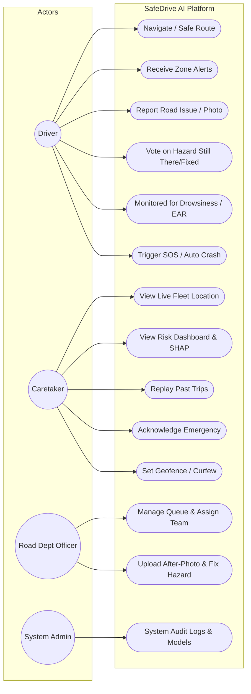
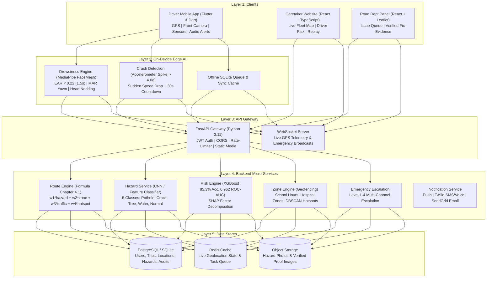
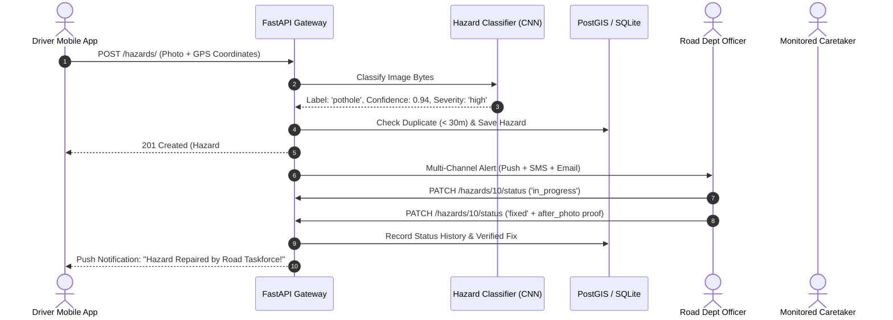
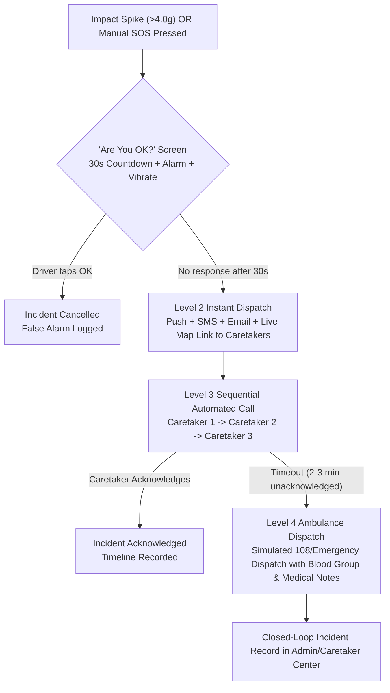
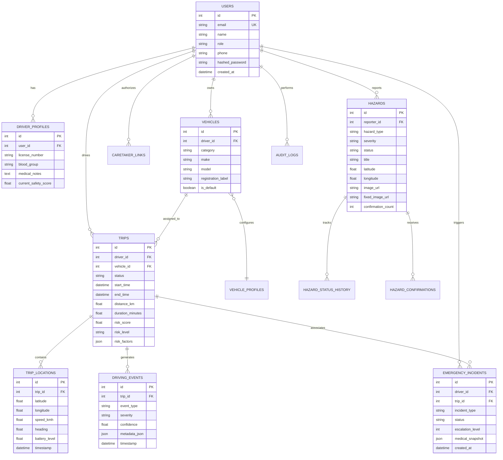

# SafeDrive AI — System Diagrams & Architectural Blueprints

*Corresponding to the Final-Year Major Project Report & Master Blueprint.*

---

## 1. Use-Case Diagram (Blueprint Figure 1.3)

---

## 2. Master System Blueprint: Layered Architecture (Blueprint Figure 2.1)

---

## 3. End-to-End Road Hazard Lifecycle (Blueprint Figure 5.1 & 5.4)

---

## 4. Emergency Escalation Flowchart (Blueprint Figure 7.1)

---

## 5. Complete Database Entity Relationship (ER) Diagram (Blueprint Figure 11.1)

